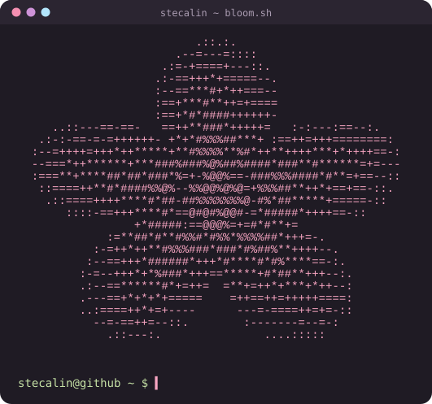

# Hi ♡ I'm Stephania Calin

**Computer Science @ Binghamton University '28 • Mobile & Full-Stack Developer • Game Dev**

---

## 🌸 Connect with Me

---

## 🎀 About Me

- 🗣️ Building the website for **Stutter Forward**, an evidence-based online community for people who stutter (Firebase + Cloudflare)
- 🛍️ Co-founder & front-end dev at **Coveted**, a React Native marketplace with Stripe payments
- 👻 Designing **Cryptid Hunt**, an asymmetric social-deduction game in Roblox Studio
- 🧠 VP of Technical Events & Cybersecurity Team Lead @ **StackHacks Binghamton**
- 💗 Teaching Python & Roblox game dev to 30+ students with **Girls Who Code**
- 🌍 Speaks English, Romanian, Mandarin & a little Spanish

---

## 💻 Tech Stack

  

---

## 🧸 Featured Projects

<table>
<tr>
<td width="50%" valign="top">

#### 📰 [Relief Wire](https://github.com/stecalin/news-relief-app)
News app that links breaking stories to relief organizations, with accounts, comments, and a custom native UI.
 `React Native` `Expo` `Firebase`

</td>
<td width="50%" valign="top">

#### 📡 [Resume Radar](https://github.com/stecalin/resume-radar)
Chrome extension using the Claude API to score job fit 0–100, tailor resume bullets, and track applications.
 `JavaScript` `Claude API` `Manifest V3`

</td>
</tr>
<tr>
<td width="50%" valign="top">

#### 💅 [Dupe Finder](https://github.com/stecalin/dupe-finder)
Full-stack app that finds affordable dupes for luxury products with live Amazon data. **[✨ try it live](https://dupe-finder-sandy.vercel.app)**
 `React` `Node` `Express` `MongoDB`

</td>
<td width="50%" valign="top">

#### 👻 Cryptid Hunt
Asymmetric social-deduction game with shapeshifting disguises, scanner cooldowns, and ambush vs. chase attacks.
 `Roblox Studio` `Lua`

</td>
</tr>
</table>

---

## 📊 GitHub Analytics

---

## 📈 Contribution Graph

---

*thanks for stopping by ♡*

